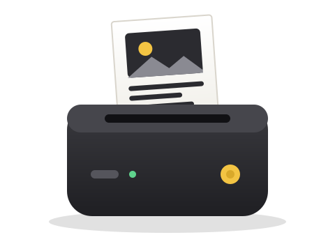
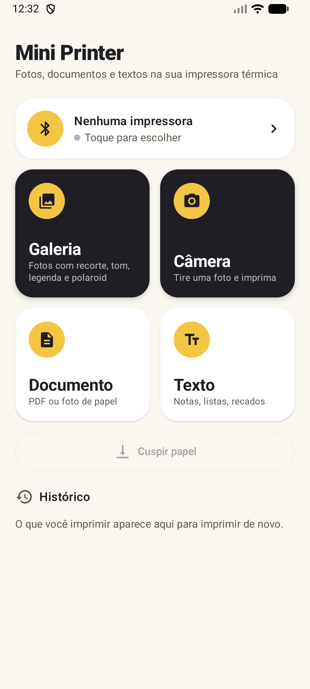
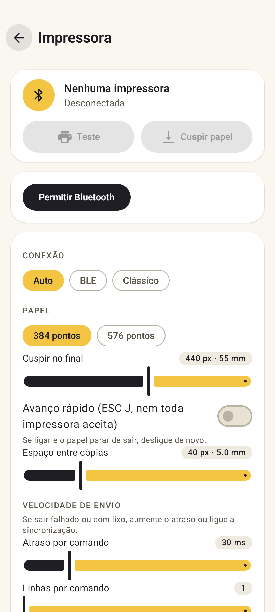

<p align="center">
  
</p>

<h1 align="center">Mini Printer</h1>

<p align="center">
  App Android para imprimir fotos, documentos e textos em mini impressoras térmicas Bluetooth de 58 mm.
</p>

<p align="center">
  <a href="https://github.com/this-claudio/Mini-Print/releases/latest"><b>⬇ Baixar APK</b></a>
  · Android 8.0+ · <a href="LICENSE">MIT</a>
</p>

---

## Telas

<p align="center">
  
  &nbsp;&nbsp;
  
</p>

## Recursos

- **Galeria e câmera** — recorte, rotação e espelhamento, ajuste de tom, bordas (incluindo polaroid) e legenda. Várias fotos de uma vez.
- **Documento** — PDF página a página ou foto de papel.
- **Texto** — notas, listas e recados com fonte, tamanho e negrito.
- **Compartilhar** — imprima direto de outros apps (imagens, PDF e texto) pelo menu "Compartilhar".
- **Histórico** — reimprima o que já saiu.
- **Ajustes da impressora** — BLE ou Bluetooth clássico (SPP), largura 384/576 pontos, avanço de papel, espaço entre cópias e velocidade de envio.

## Impressoras compatíveis

Testado com a **YHK-ECFA** (ESC/POS `GS v 0`, 384 pontos/linha). Deve funcionar com outras mini impressoras
ESC/POS de 58 mm (nomes Bluetooth como `MR.IN*`, `MHT-*`, `YHK*`, `G5-*`).

Impressoras do protocolo "cat printer" (`GB01`, `MX05`, `X6` …) ainda não são suportadas.
Detalhes do protocolo em [docs/PROTOCOL.md](docs/PROTOCOL.md).

## Instalação

1. Baixe `MiniPrinter-vX.Y.apk` em [Releases](https://github.com/this-claudio/Mini-Print/releases/latest).
2. Abra o arquivo no celular e permita instalar de fontes desconhecidas.
3. Ligue a impressora, abra o app e toque em **Nenhuma impressora** para parear.

## Compilar

Requer JDK 17 e Android SDK 36.

```bash
./gradlew assembleRelease   # app/build/outputs/apk/release/app-release.apk
./gradlew test              # testes unitários
```

## Licença

[MIT](LICENSE). Projeto independente, sem vínculo com fabricantes de impressoras ou outros apps.
